

# NieR Gestalt — PC e Android (recompilação estática)

*[English below](#nier-gestalt--pc-and-android-static-recompilation).*

Porte não oficial de **NieR Gestalt** (Xbox 360) para **Windows** e **Android** (experimental), feito por
**recompilação estática**: o código do jogo é traduzido de PowerPC para x86-64 / arm64 e compilado como um programa
nativo. Não é um emulador. A imagem é desenhada pelo **[Renut](#agradecimentos)**, que leva os desenhos do jogo direto
para Vulkan / Direct3D 12.

> **Você precisa ter o jogo.** O executável pronto traz só o código do jogo já traduzido; nenhum arquivo do
> NieR Gestalt (imagens, sons, textos, vídeos ou shaders) vem junto ou é baixado. Tudo isso é lido da **sua** cópia
> (ISO ou pasta com o `default.xex`), feita do seu próprio disco.

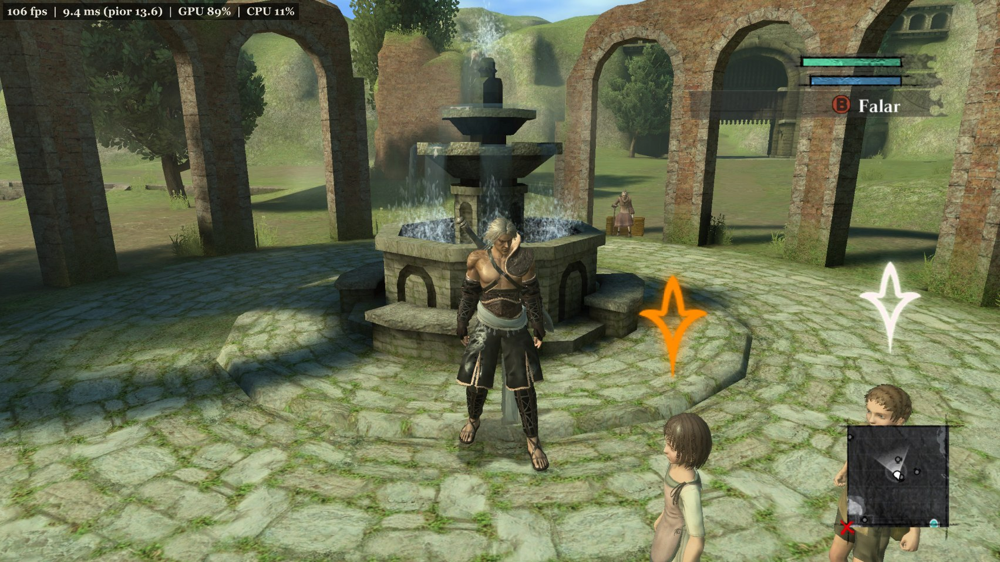

## Índice

- [O que tem](#o-que-tem)
- [PC: requisitos e instalação](#pc-requisitos-e-instala%C3%A7%C3%A3o)
- [Guarde bem a sua ISO](#guarde-bem-a-sua-iso)
- [Nitidez 3D: a resolução do próprio NieR](#nitidez-3d-a-resolu%C3%A7%C3%A3o-do-pr%C3%B3prio-nier)
- [Benchmarks no PC](#benchmarks-no-pc)
- [Android](#android-experimental)
- [Benchmarks no Android](#benchmarks-no-android)
- [Controles](#controles)
- [Mods](#mods)
- [Ferramentas: editor de texturas, de modelos e tradutor](#ferramentas)
- [Problemas conhecidos](#problemas-conhecidos)
- [Agradecimentos](#agradecimentos)

## O que tem

- **Renderizador nativo ([Renut](https://github.com/masterspike52/reNut)):** sem emular a GPU do Xbox. Resolução até 4K,
  escala de resolução com AMD FSR / CAS, filtro anisotrópico até 16x, V-Sync e limite de quadros de 30 a ilimitado.
- **60 fps e além**, com a velocidade do jogo certa.
- **Opções de Vídeo, Controles e Idioma dentro dos menus do jogo** (Opções do menu inicial e da pausa), com o visual
  original, além de Sair para a Área de Trabalho.
- **Teclado e mouse** de verdade, e controles pelo SDL3 (veja [Controles](#controles)).
- **Ajuste da tela** para telas mais largas que 16:9, incluindo o **Widescreen real** (mais visão dos lados, HUD nas
  bordas).
- **Conquistas** do próprio jogo (41), com aviso na tela e página no menu inicial e no Memorando do Grimoire Weiss.
- **Medidor de desempenho** (F2): fps, tempo de quadro, uso de GPU e CPU (no Android também RAM e temperatura).
- **Tradução para português do Brasil** (textos do jogo e do PC), já incluída; escolha em Opções → Idioma.
- **Mods** (código e troca de arquivos) e **ferramentas** para criar mods e traduções.

| Opções do menu inicial | Vídeo | Idioma |
|---|---|---|
| 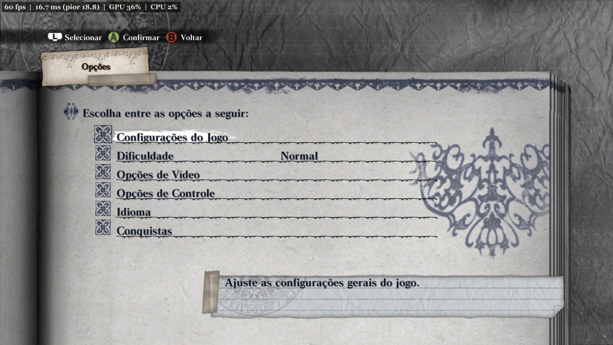 | 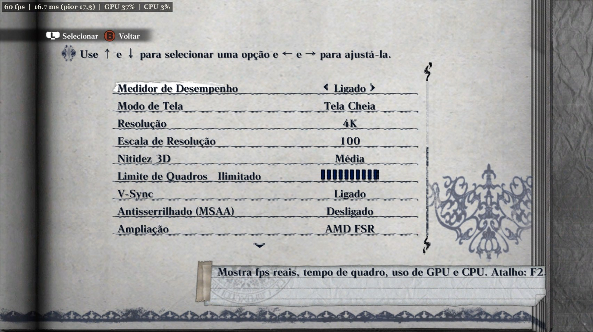 | 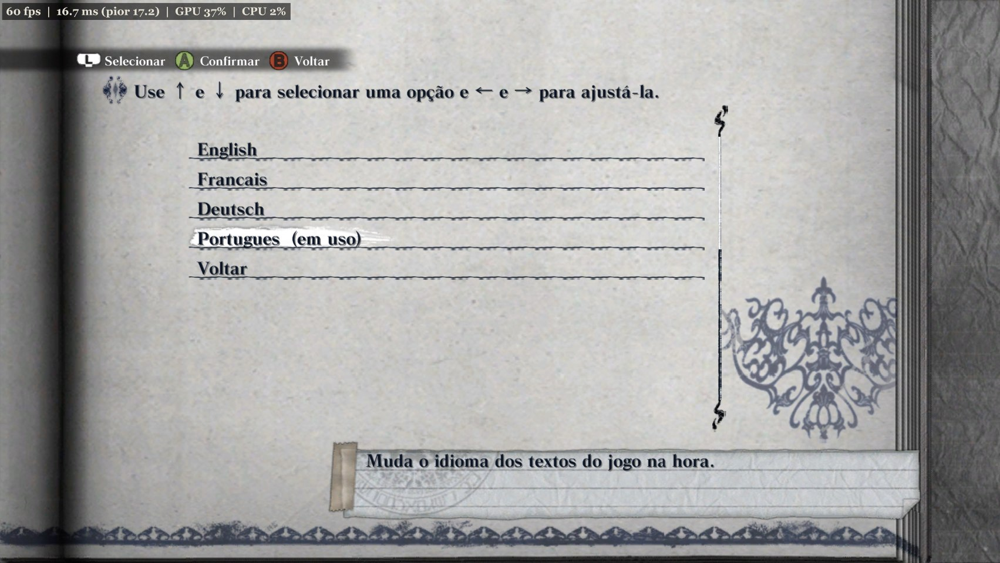 |

| Opções no menu de pausa | Mods no menu de pausa |
|---|---|
| 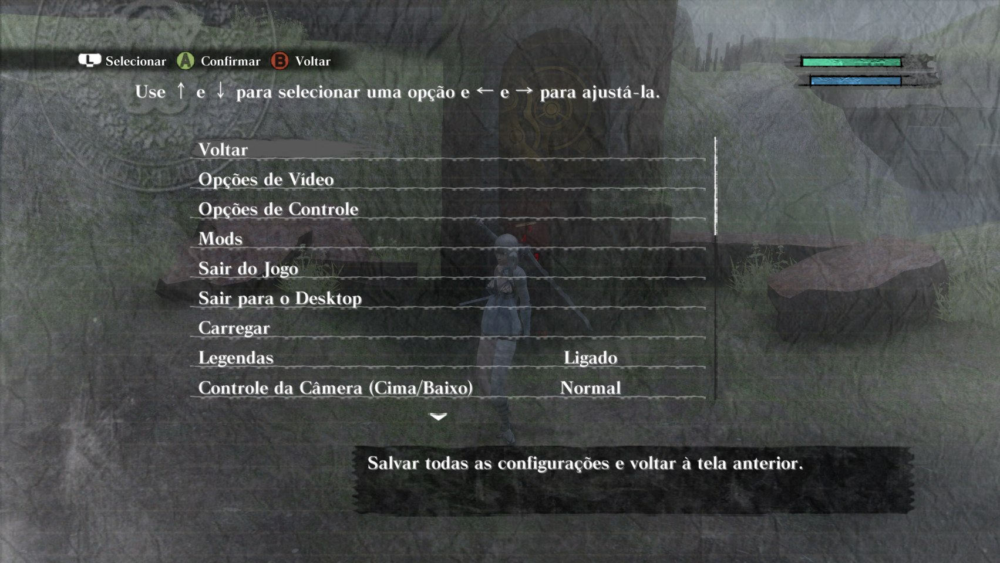 | 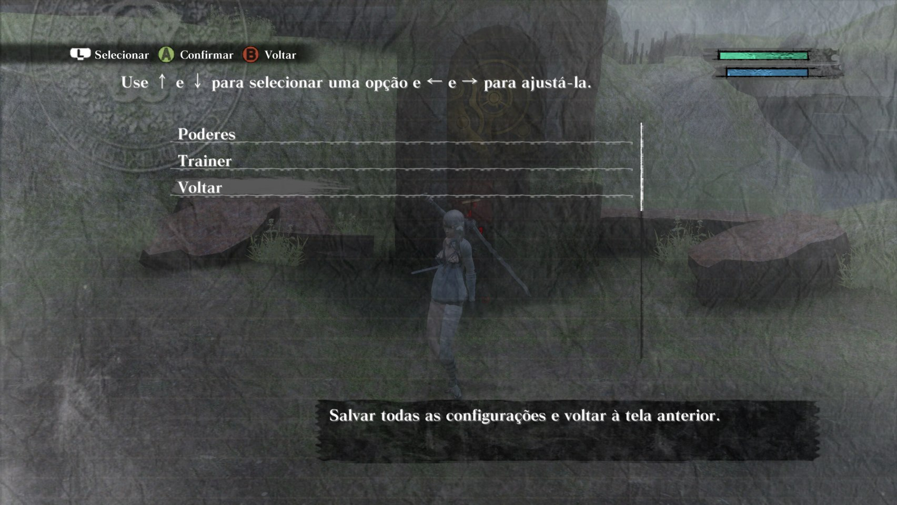 |

## PC: requisitos e instalação

**Requisitos**
- Windows 10 ou 11, 64 bits.
- Placa de vídeo com **Vulkan 1.1** ou **Direct3D 12** (feature level 11_0).
- A sua cópia do NieR Gestalt de Xbox 360 (`.iso` ou pasta com `default.xex`).

**Instalação**
1. Baixe o `.zip` da versão mais nova em **Releases** e extraia numa pasta.
2. Abra o **`NieR Gestalt.exe`**.
3. Na primeira abertura, uma janela (português, inglês ou espanhol) explica o que precisa e pede a sua cópia:
   a ISO ou a pasta com o `default.xex`. Ela:
   - confere se é o NieR Gestalt de Xbox 360;
   - guarda o caminho (não copia nada; a ISO fica onde está);
   - usa o ícone do seu disco na janela e no atalho da área de trabalho.
4. Pronto: o jogo abre. Nas próximas vezes ele vai direto.

Não precisa compilar nada nem editar arquivos. Os shaders são preparados na primeira vez que aparecem; os primeiros
minutos podem ter travadinhas que somem com o tempo.

<b>Compilar do código-fonte (opcional, para quem quer mexer no código)</b>

Precisa de ~10 GB livres e de 20 a 60 minutos.

1. Baixe este repositório (**Code → Download ZIP**, ou `git clone`).
2. Dê dois cliques em **`Preparar.cmd`** e escolha a sua ISO ou a pasta do jogo. Ele confere a cópia e as
   ferramentas (Visual Studio Build Tools com C++, LLVM 20, CMake, Git; diz como instalar o que faltar), compila o
   ReXGlue SDK na versão certa com o patch deste projeto, gera e compila o código do jogo e cria o atalho.

## Guarde bem a sua ISO

> **O jogo lê tudo da ISO toda vez que roda** (imagens, sons, falas, vídeos): ela não é copiada nem instalada.
> Se a ISO (ou a pasta do jogo) for **apagada, renomeada ou movida**, ou se o disco / pendrive / cartão SD onde ela
> está não estiver conectado, **o jogo não abre** e pede a cópia de novo.
>
> - Deixe-a numa pasta fixa, de preferência num disco interno.
> - Mantenha um backup dela.
> - Os seus saves não ficam na ISO.

Vale para o PC e para o Android.

## Nitidez 3D: a resolução do próprio NieR

O NieR Gestalt original já tinha um sistema próprio de resolução: no Xbox 360 a **cena 3D** era desenhada num tamanho
menor (768x432) quando o jogo ficava pesado, enquanto **HUD, textos, menus e legendas continuavam nítidos**. Este
porte deixa você escolher esse nível em **Opções → Vídeo → Nitidez 3D**:

| Nitidez 3D | O que faz |
|---|---|
| **Máxima** | A cena 3D na resolução inteira escolhida. |
| **Média** / **Mínima** | Os níveis menores do próprio jogo. O tamanho da Mínima se escolhe em **Nitidez 3D mínima**: 768x432 (o original), 640x360 ou 512x288. |
| **Auto** | Fica na Máxima enquanto o limite de quadros é atingido e baixa só o necessário quando o jogo pesa (a regra original só funcionava a 30 fps; esta segue o seu limite). |

**Por que usar a Nitidez 3D em vez de baixar a Resolução ou a Escala?** Baixar a Resolução (ou a Escala abaixo de
100%) diminui **tudo**, inclusive o HUD, as letras e os menus, que ficam borrados. A Nitidez 3D diminui **só a cena
3D**, que é onde está o peso, e os efeitos do jogo foram feitos para esses níveis. Na prática: a mesma economia de GPU
com a interface continua nítida.

> **Exceção — Snapdragon mais novos (Adreno 7xx):** num Adreno 740, com a cena 3D abaixo de ~80% de 720p e só em
> algumas áreas, aparecem buracos piscando nos personagens (veja [Problemas conhecidos](#problemas-conhecidos)). Se
> acontecer, deixe a Nitidez 3D em **Máxima** e, se precisar de fps, use a
> Resolução. Mali e Xclipse não têm esse problema.

## Benchmarks no PC

**Máquina de teste**

| Peça | Modelo |
|---|---|
| Processador | AMD Ryzen 7 2700 (8 núcleos / 16 threads) |
| Placa de vídeo | **AMD Radeon RX 580 2048SP** (driver 31.0.21923.11000) |
| Memória | 16 GB DDR4 a 2667 MHz |
| Placa-mãe | ASRock B450M-HDV R4.0 |
| Armazenamento | **HD** Seagate 750 GB (o jogo e a ISO rodam do HD, não do SSD) |
| Sistema | **Windows 11 Pro** 64 bits (build 26200) |
| Renderizador | Renut, Vulkan |

**Resultados** — Vila (fonte da praça), parado. Nitidez 3D Máxima, Escala 100%, MSAA desligado, Filtro Anisotrópico 16x,
Widescreen real. Números do medidor F2.

| Resolução | fps | Tempo de quadro | GPU | Observação |
|---|---|---|---|---|
| Resolução | fps | Tempo de quadro | GPU | Observação |
|---|---|---|---|---|
| 720p | **110** | 9,2 ms | 35% | **Limitado pela CPU** (a GPU sobra) |
| 1080p | **113** | 8,8 ms | 65% | **Limitado pela CPU** (a GPU sobra) |
| 1440p | **106** | 9,4 ms | 89% | Sem limite |
| 4K | **55-57** | 17,5 ms | 94% | V-Sync ligado (tela de 60 Hz) |

Em 720p e 1080p quem segura o fps é o processador (a lógica do jogo), não a placa: a GPU fica em 35-65% e o fps é o
mesmo (~110) nas duas resoluções.

Resumo: a RX 580 roda **1440p acima de 100 fps** e **4K perto de 60 fps**. Para 4K a 60 fps com folga, use
**4K + Nitidez 3D Média ou Mínima + AMD FSR**: a interface continua em 4K e só a cena 3D fica menor.

**Outra máquina: NVIDIA GeForce RTX 4060** (Vulkan, monitor 1080p, fps destravado):

| Resolução da cena 3D | fps | GPU por quadro |
|---|---|---|
| 4K (3840x2160) | **~105-112** | ~8,2-8,9 ms |
| 8K (7680x4320) | **~64-83** | ~11-13 ms |

Com 60 fps travados (vsync), o 4K usa só ~50% da placa. Em 4K e 8K quem segura o fps é a placa; a lógica do jogo
deixa passar de 220 fps nas telas leves.

| 4K | 1440p | 1080p |
|---|---|---|
| 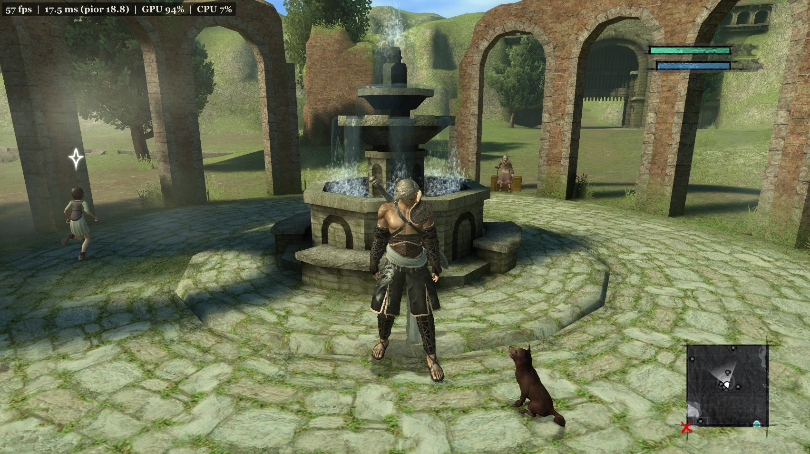 |  | 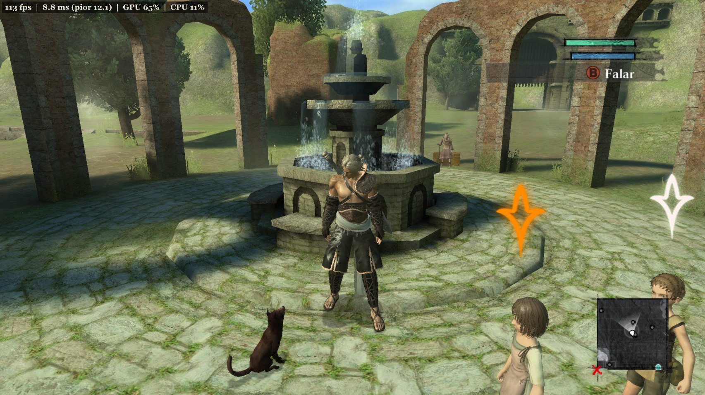 |
| 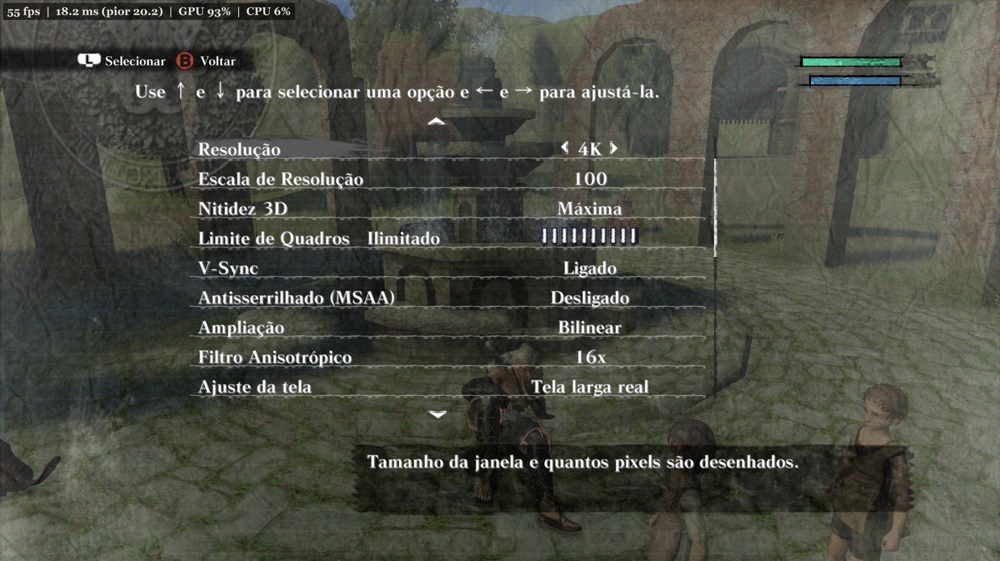 | 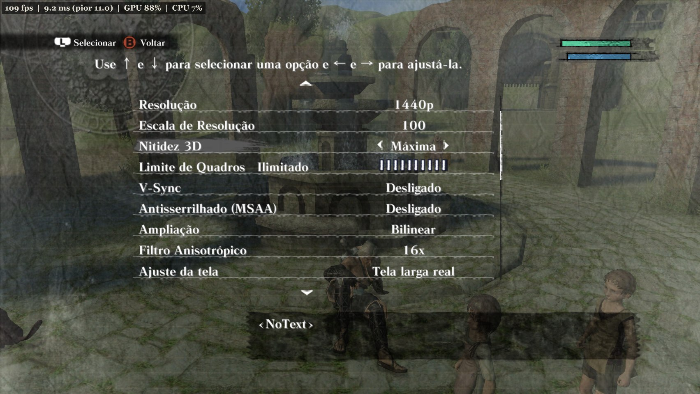 | 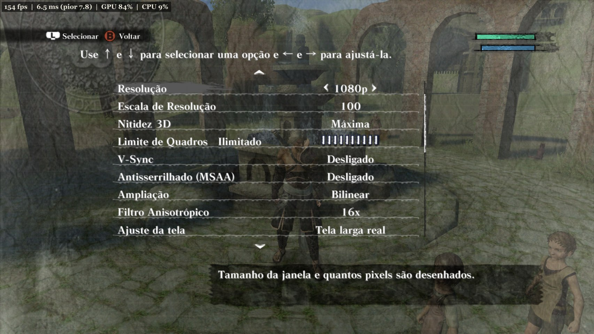 |

| 720p | 720p, Widescreen real |
|---|---|
| 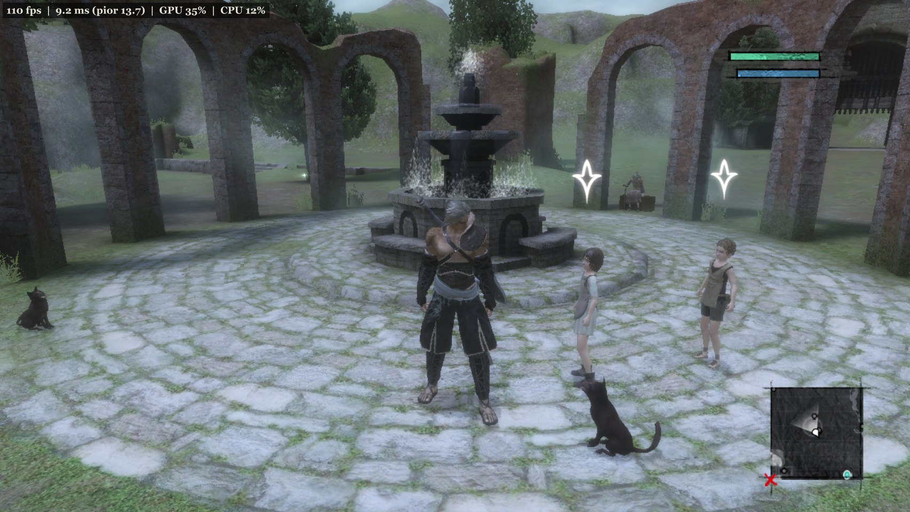 |  |

## Android (experimental)

A mesma recompilação roda em celulares e portáteis **Android** (arm64, Vulkan), com o mesmo renderizador Renut.

**Como funciona:** o APK **Projeto Gestalt** (nas *Releases*) não traz nada do jogo. Ao abrir, ele pede "Acesso a
todos os arquivos" e a sua ISO (ou a pasta com o `default.xex`), prepara o que precisa a partir dela e instala o app
**NieR Gestalt**, com o ícone do seu disco. Depois disso o Projeto Gestalt pode ser desinstalado. Os arquivos ficam em
`/sdcard/NierPort` (`nier.toml`, `log.txt`, `MODS`). Como no PC, **a ISO continua sendo usada** a cada abertura: não
apague nem mova (veja [Guarde bem a sua ISO](#guarde-bem-a-sua-iso)).

**Requisitos:** Android 64 bits (arm64), Vulkan 1.1, ~4 GB de RAM livres para a memória do jogo, a sua ISO no
aparelho.

**Telas de celular (20:9 e mais largas):** com o **Widescreen real** (Opções → Vídeo → Ajuste da tela) o jogo enche
a tela inteira sem esticar: o personagem fica na proporção certa, você vê mais dos lados e o HUD vai para as bordas.
No Poco F6 Pro (20:9) funciona perfeitamente — todas as prints do Android abaixo estão nesse modo.

**Controles e menus por toque**
- **Botões na tela** com a arte do próprio jogo: analógico flutuante, câmera arrastando o dedo no lado direito,
  sigilo da magia de cada botão (LB/RB/LT/RT), esquiva, defesa, itens e armas.
- Os botões mudam com o momento: no menu inicial só Start e A; nos menus A, B e analógico; no jogo, só as magias e
  armas que você já tem.
- **Menus do jogo por toque:** tocar nas opções, arrastar para rolar (inclusive as Opções originais e as lojas),
  setas de quantidade nas lojas, botão de voltar no canto.
- Telas de escolha (diálogos) e a pesca usam o analógico e o A/B na tela; na pesca o dedo ainda gira a câmera.
- **Editor de posição:** arraste cada botão e mude o tamanho com − / +. Tamanho, opacidade e velocidade da câmera
  ficam em **Opções → Controles**. Os botões somem sozinhos quando um controle é conectado (ou: Sempre / Desligado).
- Tela sempre deitada (paisagem para os dois lados).

| Menu inicial | Jogo com os botões na tela | Editor de posição dos botões |
|---|---|---|
| 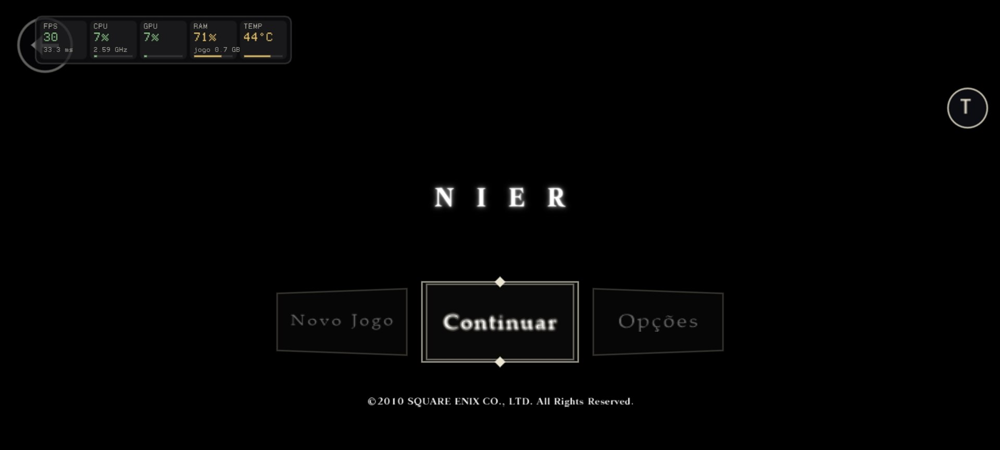 | 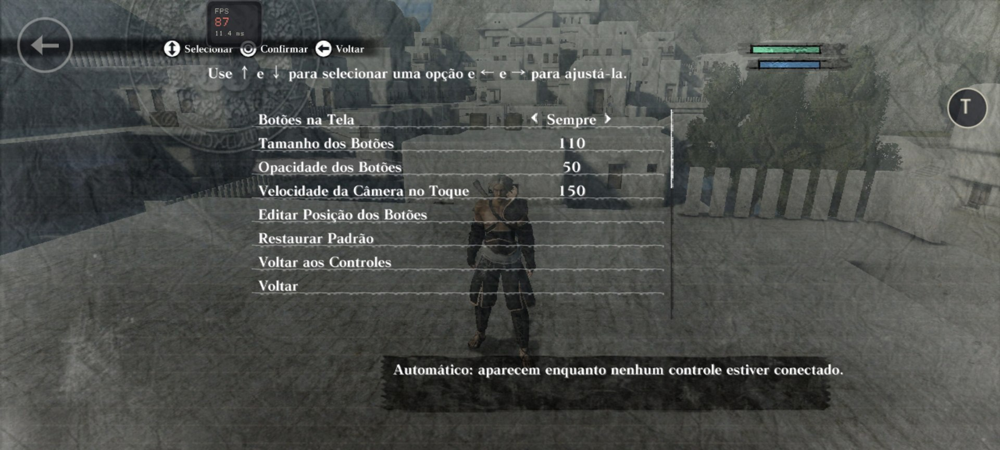 | 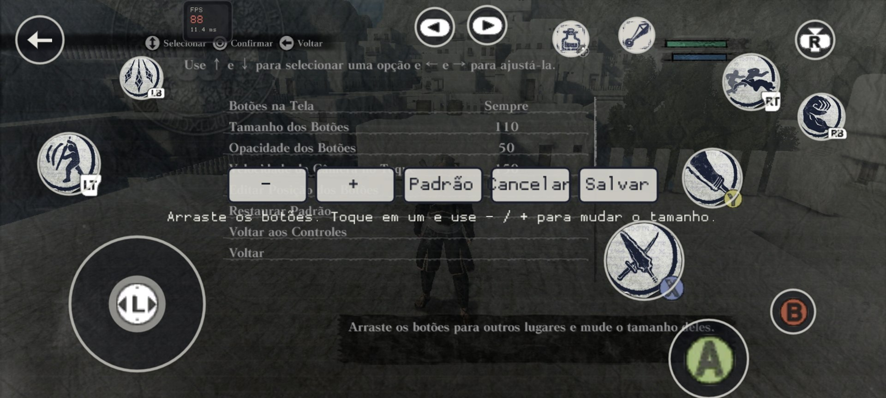 |

## Benchmarks no Android

### Snapdragon 8 Gen 2 (Poco F6 Pro, Adreno 740)

Façade (telhados), parado. Nitidez 3D Máxima, Escala 100%, MSAA desligado, Filtro 16x, Widescreen real, limite de
120 fps, V-Sync ligado.

> **Atenção:** estas prints foram tiradas com o aparelho **sob estresse** — horas de testes seguidos, já quente
> (62-69 °C), com o medidor e a captura ligados. Em uso normal o **fps é maior** que o das prints. Para sessões longas
> use o limite de 30 ou 60 fps: o celular esquenta menos e mantém o clock.

| Resolução | fps | Tempo de quadro | GPU | Temperatura |
|---|---|---|---|---|
| 720p | **85** (medidas anteriores: até 88) | 11,7 ms | 99% | 63 °C |
| 1080p | **59-60** | 16,7 ms | 100% | 68-69 °C |
| 1440p | **40-41** | 24,7 ms | 100% | 65 °C |
| 4K | 13-15 | 71 ms | 100% | 62 °C |

| 720p | 1080p | 1440p | 4K |
|---|---|---|---|
| 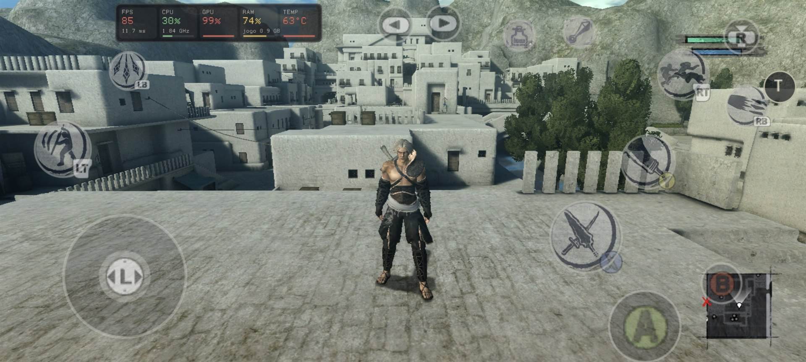 | 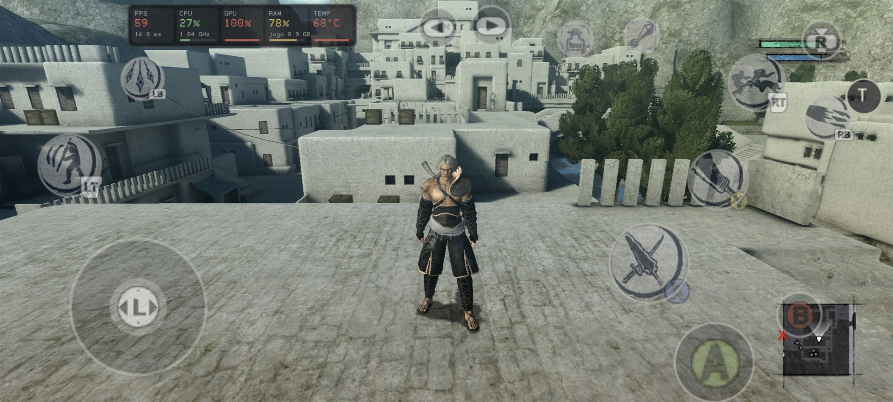 | 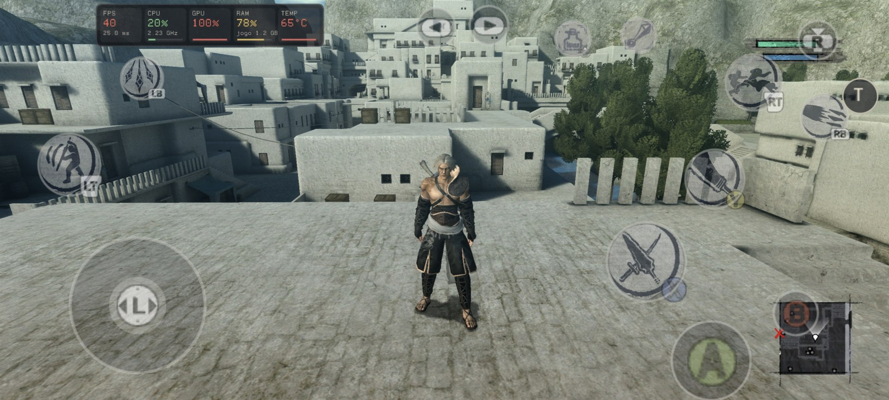 | 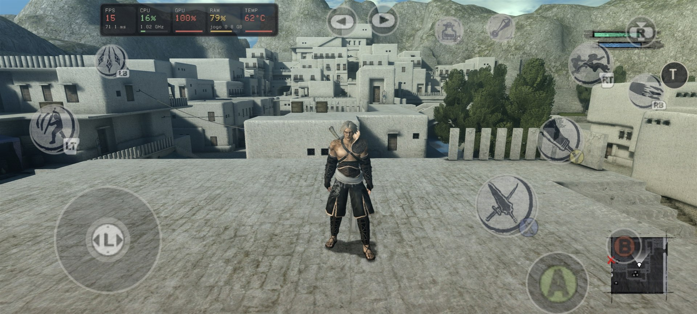 |
| 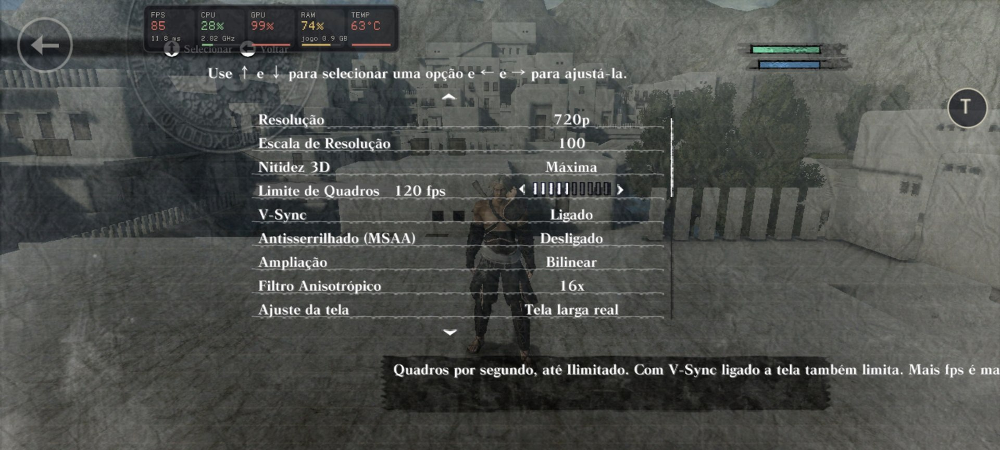 | 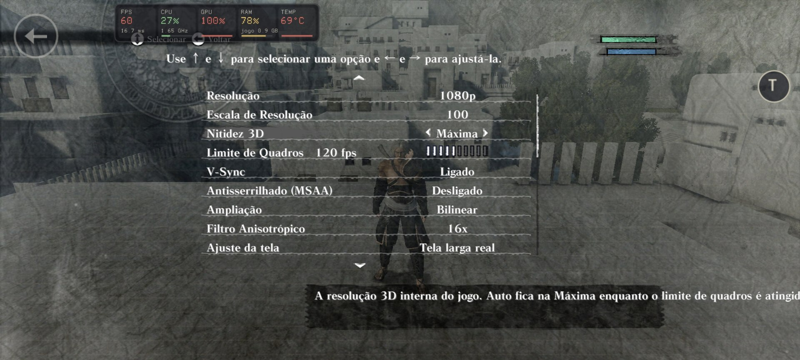 | 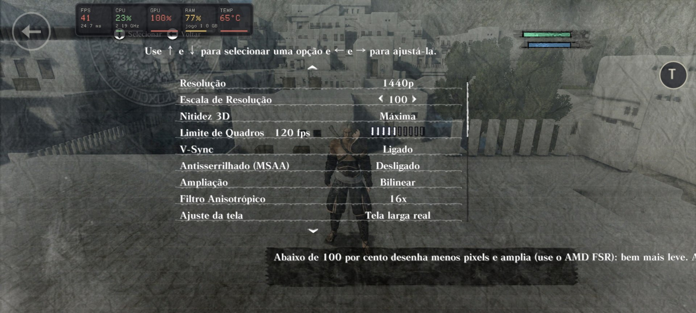 | 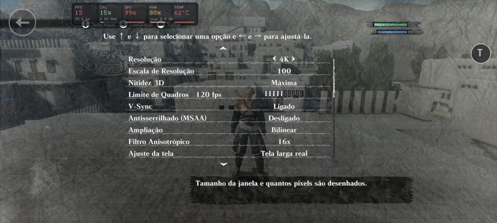 |

### Mali-G57 MP1 (portátil Unisoc T620)

Vila, 360p, Nitidez 3D Máxima, MSAA desligado, Filtro 8x, limite de 75 fps: **~35 fps** (28,6 ms, GPU 95%). Em
outras cenas medidas: ~30-32 fps no Lost Shrine e ~29 fps na luta das estátuas, também em 360p.

| Vila, 360p | Opções usadas |
|---|---|
| 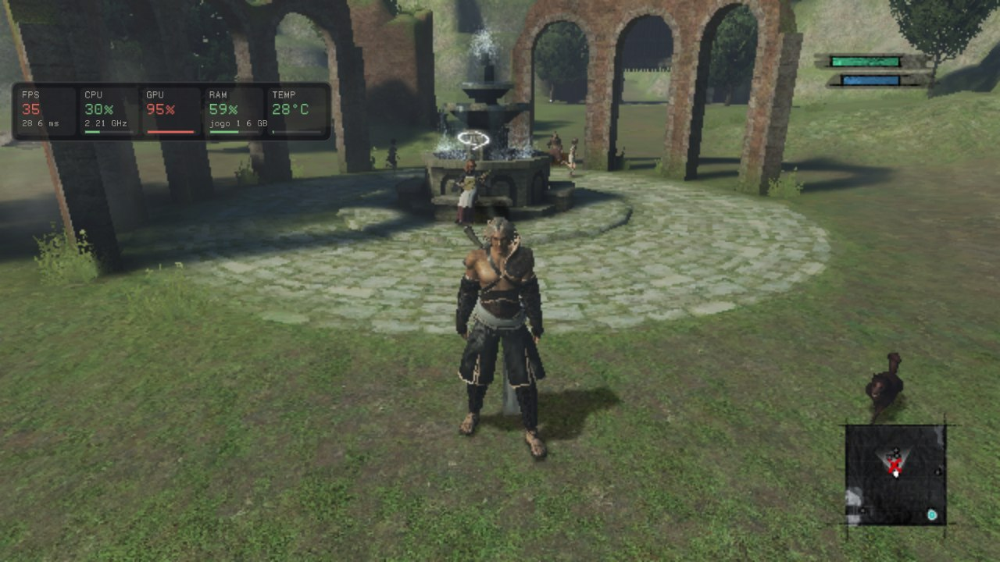 | 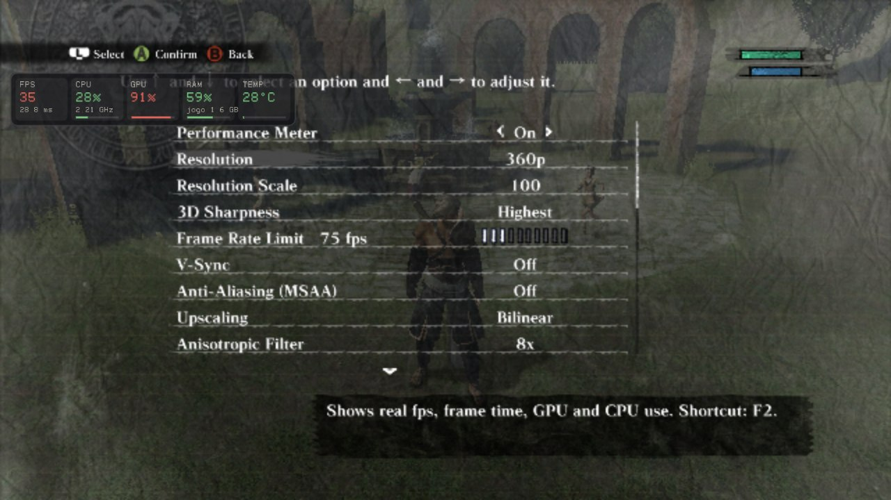 |

> **Mali-G57 MP1 não é o Mali-G57 do Helio G99.** "Mali-G57" é o nome de uma família; o número depois do "MP/MC" é a
> quantidade de núcleos da GPU.
>
> | | Unisoc T620 (o testado) | MediaTek Helio G99 |
> |---|---|---|
> | GPU | Mali-G57 **MP1** — 1 núcleo, ~850 MHz | Mali-G57 **MC2** — 2 núcleos, ~1,1 GHz |
> | Força da GPU | 1x | **~2,5x** |
> | CPU grande | 2x Cortex-A75 | 2x Cortex-A76 a 2,2 GHz |
>
> Ou seja, os números acima são do Mali-G57 **mais fraco** que existe. Um Helio G99 deve rodar bem mais rápido
> (provavelmente 30 fps em resoluções acima de 360p), mas **ainda não foi medido**.

### Outros aparelhos (logs de amigos)

| Aparelho (GPU) | Configuração | fps na gameplay |
|---|---|---|
| Galaxy A56 (Exynos 1580, **Xclipse 540**) | 1080p | **35-41** (60 nos menus) |
| Galaxy M54 (Exynos 1380, **Mali-G68 MP5**) | 720p | **29-35** (GPU ~30 ms; 60 nos menus) |
| | 1080p | 21-25 (GPU ~40-45 ms) |
| Poco C75 (Helio G81, **Mali-G52 MC2**) | 720p | **~10-19** (média ~10,5; GPU ~49 ms) |
| Snapdragon 695 (**Adreno 619**) | 360p, Nitidez 3D Média/Mínima | **~59-65** (GPU ~13 ms) |
| | 720p, Nitidez 3D Média/Mínima | 23-44, conforme a cena (GPU ~22-42 ms) |
| | 1080p | ~18 (GPU ~55 ms) |

Em 720p o Mali-G52 MC2 fica no nível do Mali-G57 MP1 (~12 fps), então nele também vale usar 360p. O Snapdragon 695
roda a 60 fps em 360p e fica perto de 30 em 720p.

**Aparelhos testados sem fps constante para medir:**
- Galaxy A14 (**Mali-G52 MC2**): abre e roda os menus; travava ao entrar na fase (correção feita, falta o teste).

Os problemas desses aparelhos estão em [Problemas conhecidos](#problemas-conhecidos).

**Resumo:** um Mali-G57 MP1 joga a ~30-35 fps em 360p; um Snapdragon 8 Gen 2 passa de 60 fps em 720p e segura 60 em
1080p. Para menos calor e bateria, use o limite de 30 fps (como no console).

## Controles

**Controles físicos (PC e Android):** tudo que o **SDL3** reconhece — Xbox (360, One, Series), PlayStation
(DualShock 4, DualSense), Switch Pro e a maioria dos genéricos, por USB ou Bluetooth. Os botões aparecem como no
Xbox 360. No Android, com um controle conectado os botões na tela somem sozinhos.

**Teclado e mouse (PC):**

| Ação | Tecla |
|---|---|
| Andar | W A S D |
| Câmera | Mouse (ou setas, se "Mouse na câmera" estiver desligado) |
| Pular / confirmar | Espaço, Enter |
| Ataque / ataque pesado | Clique esquerdo / direito |
| Ação | F |
| Esquiva | Ctrl |
| Defender | Shift |
| Magias | Q / E |
| Menu / voltar | Esc, P / Backspace |
| Mapa | M |
| Desempenho | F2 |

Tudo pode ser trocado em **Opções → Controles**. O cursor do mouse funciona nos menus do próprio jogo. Com um
controle conectado, o teclado e o mouse desligam sozinhos.

**Ajuste da tela** (Opções → Vídeo, telas mais largas que 16:9): **Preencher** (corta em cima e embaixo), **Barras
pretas** (16:9 original), **Esticar**, **Widescreen** (a câmera abre um pouco, HUD na proporção certa) e
**Widescreen real** (o personagem continua em 16:9, você vê mais dos lados e o HUD vai para as bordas).

## Mods

Os mods ficam em `MODS\<nome do mod>` (no Android, `/sdcard/NierPort/MODS`) e aparecem na linha **Mods** do menu de
pausa e das Opções. Há dois tipos:

- **Mods de arquivo:** trocam texturas, modelos, textos ou sons do jogo (feitos com as [ferramentas](#ferramentas)).
- **Mods de código:** uma `.dll` (PC) ou `.so` (Android) com um painel próprio (tecla no PC, ícone na tela no
  Android). A API em C fica em `mods/sdk/nier_mod.h`, com exemplos em `mods/`:
  - **Trainer** (F5): invencibilidade, vida e magia infinitas, dano x, pulo infinito, ouro e experiência, **câmera
    livre**;
  - **Jukebox** (F6): toca qualquer música do jogo, playlists, troca a música de cada lugar.

| Mods | Jukebox | Opção da Jukebox |
|---|---|---|
| 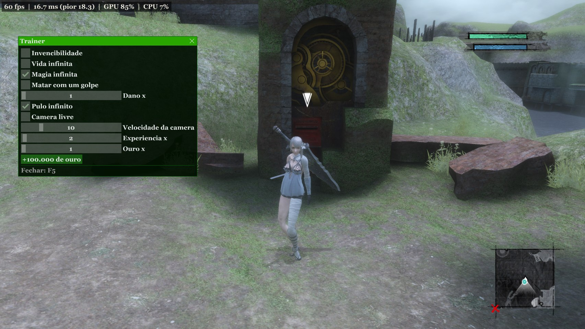 | 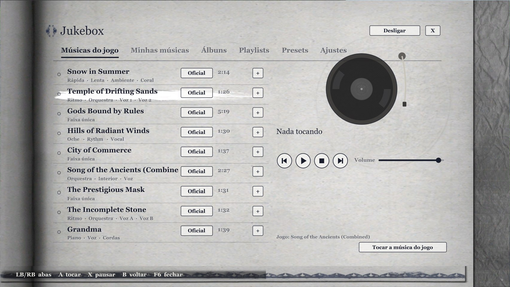 | 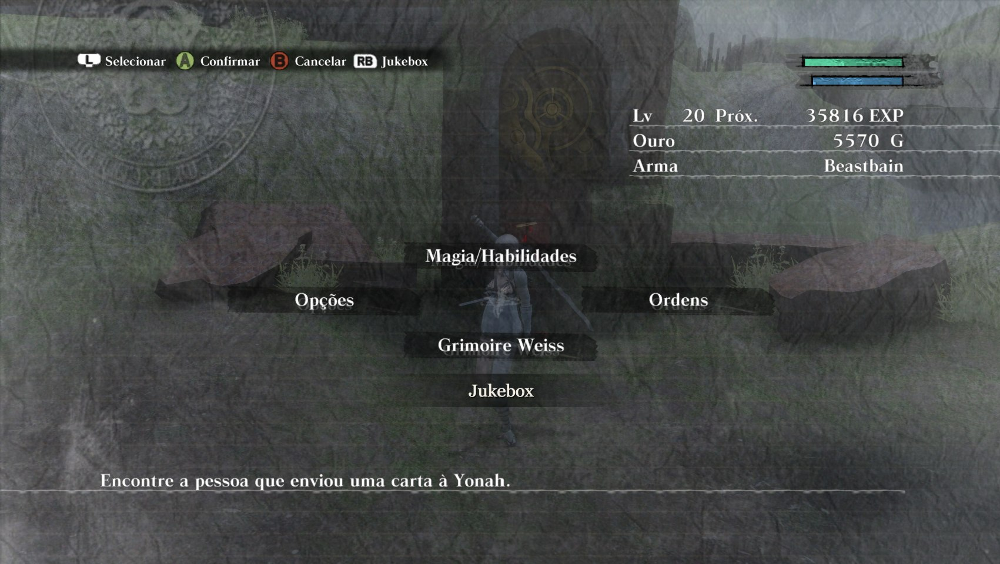 |

| Câmera livre (Trainer) | |
|---|---|
| 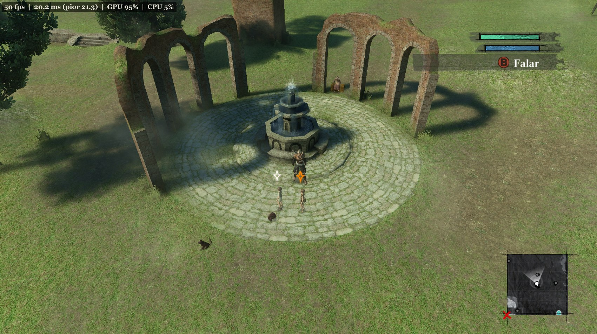 | 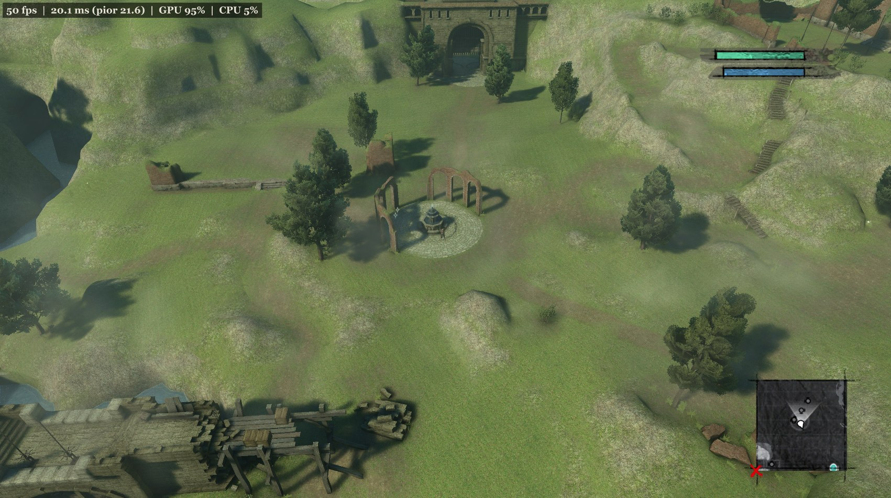 |

## Ferramentas

Ficam na pasta `tools\` e são opcionais (o jogo não precisa delas). Cada uma se compila com o `build.ps1` da própria
pasta e o `.exe` fica ao lado do `NieR Gestalt.exe`.

- **NierTextureTool — editor de texturas** (`tools\textures`, sem argumentos abre a janela em português, inglês ou
  espanhol): veja as texturas 2D do jogo (menus, título, ícones), troque por um PNG (ou arraste), restaure e salve.
  **Gerar** cria um mod em `MODS\<nome>` ou uma tradução em `TEXT\<idioma>`.
- **NierTextureTool — editor de modelos 3D:** visualize os personagens, apague partes, troque texturas, **importe
  modelos FBX/OBJ** (com esqueleto e texturas) e use **Jogar com este corpo** para trocar o corpo do Nier por outro
  personagem. Também funciona por linha de comando (`list`, `find`, `cat`, `extract`, `build`, `unpack`, `roundtrip`).
- **NierTradutor** (`tools\translator`): abre no navegador uma página local para editar os textos do jogo (falas,
  legendas, menus) e gerar uma pasta `TEXT\<idioma>` nova.
- **nier_shader_extract** (`tools\shader_extract`): roda sozinho na compilação; tira da sua ISO os shaders do
  executável do jogo para a primeira vez que você joga ter menos travadinhas.

| Editor de texturas | Editor de modelos | Editor de modelos (prévia) | Tradutor |
|---|---|---|---|
| 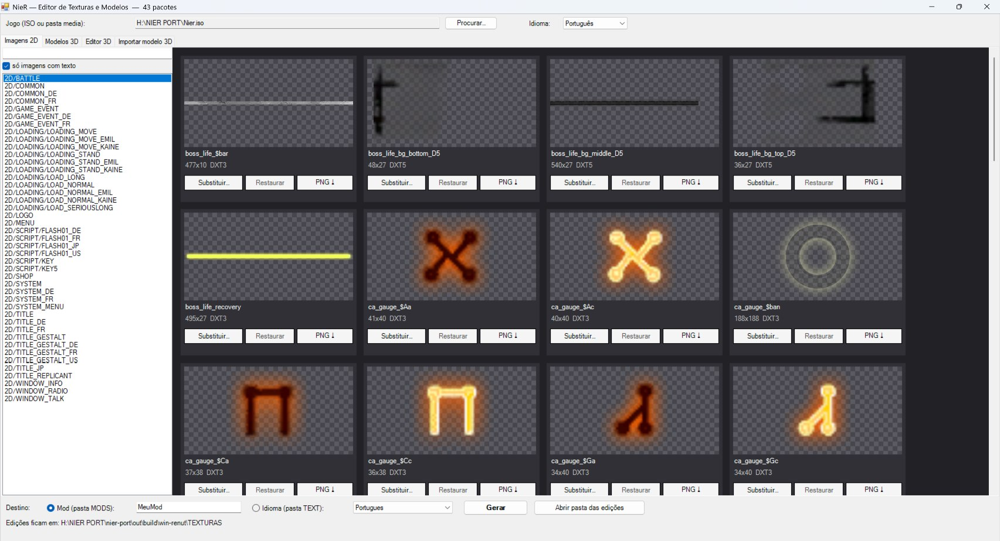 | 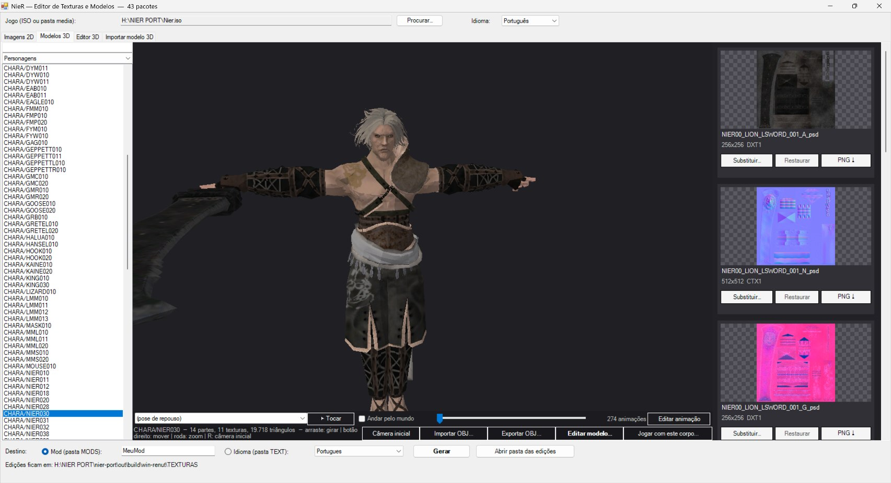 | 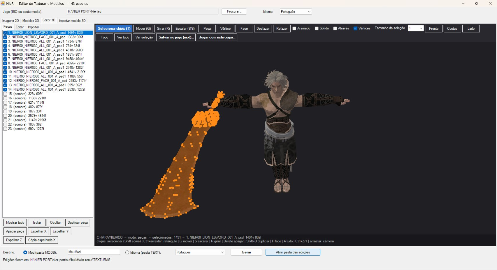 | 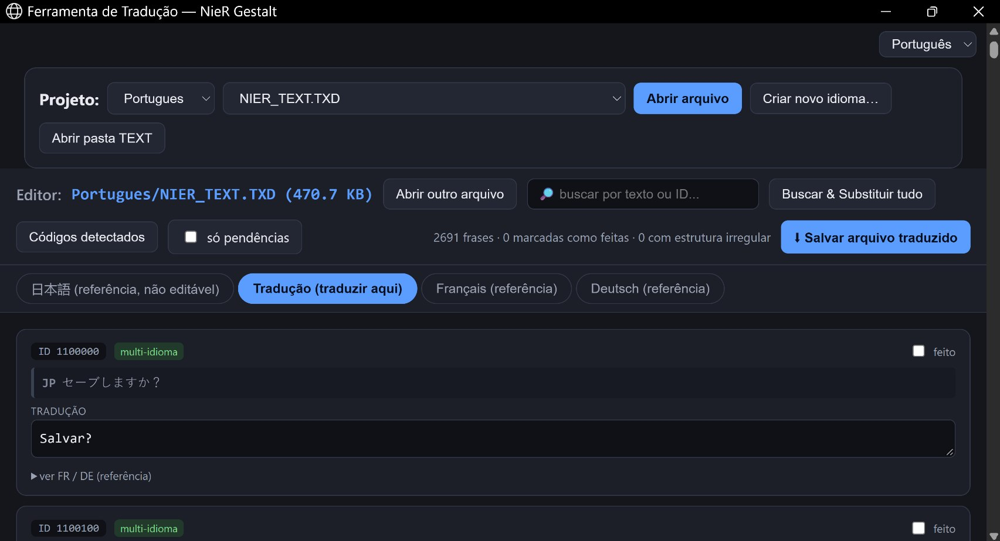 |

## Problemas conhecidos

### Android
- **Buracos piscando nos personagens (Adreno 7xx, ex.: Snapdragon 8 Gen 2):** só acontece quando três coisas se
  juntam:
  - **GPU:** visto no Adreno 740 (Poco F6 Pro) com o driver da Qualcomm. O Adreno 619 (Snapdragon 695) não tem o
    defeito, mesmo com a Nitidez 3D reduzida; com o driver aberto Turnip (Mesa) ele também some, então é do driver.
  - **Resolução:** a cena 3D abaixo de ~80% de 720p (Nitidez 3D Média/Mínima ou resolução baixa).
  - **Área:** só em algumas áreas, onde o jogo desenha partes do corpo do Nier com uma versão específica do shader de
    pele. Saindo da área os buracos somem; voltando, aparecem de novo.

  Causa provável: o compilador de shaders da Qualcomm gera valores inválidos (NaN ou infinito) nessa versão do
  shader, que aparecem como pontos claros, pretos ou transparentes. Enquanto não há correção, nesses aparelhos use
  Nitidez 3D **Máxima** e resolução de 80% de 720p ou mais.
- **Mali-G52 (Galaxy A14 e parecidos):** "Vulkan device lost" logo ao entrar na fase (a imagem congela e o som
  continua). Correção feita, ainda sem teste no aparelho.
- **Xclipse (Galaxy A56):** depois de mudar uma opção de vídeo, a abertura seguinte podia ficar preta até apagar o
  `nier.toml`. Correção feita, ainda sem teste no aparelho.
- A primeira abertura logo depois de instalar já travou uma vez numa tela parada; abrir de novo resolveu.
- Os primeiros minutos têm travadinhas de 1 a 3 s (shaders sendo preparados e carregamentos); somem com o tempo.
- Os botões na tela ainda aparecem durante algumas cenas.
- Celulares quentes baixam o clock sozinhos: use o limite de 30 fps em sessões longas.

### Geral
- Imagens com texto escrito (algumas telas de menu) continuam em inglês na tradução; o título já está traduzido.
- Alguns poucos efeitos podem faltar: 10 shaders do jogo ainda não convertem (laços com constantes inteiras).
- O editor de mapas 3D do NierTextureTool está escondido até ficar estável.

## Situação

Em desenvolvimento. O jogo já é jogável no PC e no Android; outros problemas ficam nas *Issues*.

## Agradecimentos

- **[Renut](https://github.com/masterspike52/reNut)**, de **[masterspike52](https://github.com/masterspike52)** — o
  renderizador em nível de Direct3D para jogos de Xbox 360 recompilados que desenha este porte no PC e no Android.
  Sem ele não haveria imagem nativa, 4K nem Android. O autor liberou o uso e os forks
  ([issue #74](https://github.com/masterspike52/reNut/issues/74)). Obrigado!
- Os ports **banjo-nx**, **sa2-nx** e **mgr-nx-deko**, por onde o Renut chegou até aqui junto com a integração com o
  ReXGlue.
- **ReXGlue SDK**, a base da recompilação estática.
- **SDL3**, **Vulkan / volk / VMA**, **Dear ImGui**, **libadrenotools** e os outros projetos listados em
  `CREDITS.md` e `THIRD_PARTY_NOTICES.md`.

## Licença

Distribuído sob a **GPL-3.0** (`LICENSE`), porque inclui o Renut (GPL-3.0). NieR é marca da Square Enix; este projeto
não tem ligação com ela.

---

# NieR Gestalt — PC and Android (static recompilation)

An unofficial **Windows** and **Android** (experimental) port of **NieR Gestalt** (Xbox 360), made by **static
recompilation**: the game's PowerPC code is translated to x86-64 / arm64 and built as a native program. It is not an
emulator. Graphics are drawn by **[Renut](https://github.com/masterspike52/reNut)**, which sends the game's draws
straight to Vulkan / Direct3D 12. The screenshots are in the Portuguese section above.

> **You must own the game.** The ready-made executable carries only the game's code, already translated; no
> NieR Gestalt files (art, audio, text, video or shaders) ship with it or are downloaded. All of that is read from
> **your** copy (an ISO or a folder with `default.xex`) dumped from your own disc.

## Features

- **Native renderer ([Renut](https://github.com/masterspike52/reNut)):** no Xbox GPU emulation. Up to 4K, resolution
  scale with AMD FSR / CAS, up to 16x anisotropic filtering, V-Sync and a 30-to-unlimited frame rate limit.
- **60 fps and beyond**, with correct game speed.
- **Video, Controls and Language options inside the game's menus** (title and pause Options), in the original style,
  plus Quit to Desktop.
- **Real keyboard and mouse**, and gamepads through SDL3 (see [Controls](#controls-1)).
- **Screen Fit** for screens wider than 16:9, including **Real Widescreen** (more to the sides, HUD at the edges).
- The game's own **achievements** (41), with an on-screen notice and a page in the title menu and in Weiss's Notes.
- **Performance meter** (F2): fps, frame time, GPU and CPU use (plus RAM and temperature on Android).
- **Brazilian Portuguese translation** (game and PC texts), included; pick it in Options → Language.
- **Mods** (code and file swaps) and **tools** to make mods and translations.

## PC: requirements and install

**Requirements:** Windows 10 or 11, 64-bit; a GPU with **Vulkan 1.1** or **Direct3D 12** (feature level 11_0); your
own Xbox 360 copy of NieR Gestalt (`.iso` or a folder with `default.xex`).

**Install**
1. Download the latest `.zip` from **Releases** and extract it to a folder.
2. Open **`NieR Gestalt.exe`**.
3. On the first start a window (Portuguese, English or Spanish) asks for your copy: the ISO or the folder with
   `default.xex`. It checks that it is NieR Gestalt for Xbox 360, remembers the path (nothing is copied) and uses your
   disc's icon for the window and the desktop shortcut.
4. Done: the game starts, and goes straight in from then on.

Nothing to build and no files to edit. Shaders are prepared the first time they appear, so the first minutes may
stutter a little.

<b>Building from source (optional)</b>

Needs ~10 GB free and 20–60 minutes. Download this repository (**Code → Download ZIP**, or `git clone`), double-click
**`Preparar.cmd`** and pick your ISO or game folder. It checks the copy and the build tools (Visual Studio Build Tools
with C++, LLVM 20, CMake, Git — it tells you how to install what is missing), builds the pinned ReXGlue SDK with this
project's patch, generates and compiles the game code, and adds a desktop shortcut.

## Keep your ISO safe

> **The game reads everything from the ISO every time it runs** (art, audio, voices, videos): it is not copied or
> installed. If the ISO (or the game folder) is **deleted, renamed or moved**, or the drive / USB stick / SD card
> holding it is not connected, **the game will not start** and asks for the copy again. Keep it in a fixed folder,
> preferably on an internal drive, and keep a backup. Your saves are not stored in the ISO. This applies to PC and
> Android.

## 3D Sharpness: NieR's own resolution system

The original game already had its own resolution system: on Xbox 360 the **3D scene** was drawn smaller (768x432)
when the game got heavy, while **HUD, text, menus and subtitles stayed sharp**. This port lets you pick that level in
**Options → Video → 3D Sharpness**:

| 3D Sharpness | What it does |
|---|---|
| **Highest** | The 3D scene at the full chosen resolution. |
| **Medium** / **Lowest** | The game's own smaller levels. Lowest's size is set in **Lowest 3D Sharpness**: 768x432 (original), 640x360 or 512x288. |
| **Auto** | Stays at Highest while the frame rate limit is reached and lowers only as much as needed (the original rule only worked at 30 fps; this one follows your limit). |

**Why 3D Sharpness instead of lowering Resolution or Scale?** Lowering the Resolution (or the Scale below 100%)
shrinks **everything**, HUD, letters and menus included, which get blurry. 3D Sharpness shrinks **only the 3D scene**,
which is where the cost is, and the game's effects were made for those levels. Same GPU savings, sharp interface.

> **Exception — newer Snapdragons (Adreno 7xx):** on an Adreno 740, with the 3D scene below ~80% of 720p and only in
> some areas, characters show flickering holes (see [Known issues](#known-issues)). If it happens, keep 3D Sharpness
> at **Highest** and lower the Resolution if you need fps. Mali, Xclipse and the Adreno 619 are not affected.

## PC benchmarks

**Test machine:** AMD Ryzen 7 2700 (8 cores / 16 threads) · **AMD Radeon RX 580 2048SP** (driver 31.0.21923.11000) ·
16 GB DDR4-2667 · ASRock B450M-HDV R4.0 · **Seagate 750 GB HDD** (the game and the ISO run from the hard drive, not
an SSD) · **Windows 11 Pro** 64-bit
(build 26200) · Renut on Vulkan.

**Results** — Village (square fountain), standing. 3D Sharpness Highest, Scale 100%, MSAA off, 16x Anisotropic,
Real Widescreen. Numbers from the F2 meter.

| Resolution | fps | Frame time | GPU | Notes |
|---|---|---|---|---|
| 720p | **110** | 9.2 ms | 35% | **CPU-bound** (GPU to spare) |
| 1080p | **113** | 8.8 ms | 65% | **CPU-bound** (GPU to spare) |
| 1440p | **106** | 9.4 ms | 89% | Uncapped |
| 4K | **55-57** | 17.5 ms | 94% | V-Sync on (60 Hz display) |

At 720p and 1080p the processor (the game's logic) sets the frame rate, not the GPU: it sits at 35-65% and fps is the
same (~110) at both resolutions.

In short: the RX 580 runs **1440p above 100 fps** and **4K close to 60 fps**. For 4K at 60 fps with headroom, use
**4K + 3D Sharpness Medium or Lowest + AMD FSR**: the interface stays at 4K and only the 3D scene gets smaller.

**Another machine: NVIDIA GeForce RTX 4060** (Vulkan, 1080p monitor, uncapped fps):

| 3D scene resolution | fps | GPU per frame |
|---|---|---|
| 4K (3840x2160) | **~105-112** | ~8.2-8.9 ms |
| 8K (7680x4320) | **~64-83** | ~11-13 ms |

Capped at 60 fps (vsync), 4K uses only ~50% of the card. At 4K and 8K the GPU sets the frame rate; the game's logic
goes past 220 fps on light screens.

## Android (experimental)

The same recompilation runs on **Android** phones and handhelds (arm64, Vulkan), with the same Renut renderer.

**How it works:** the **Projeto Gestalt** APK (in *Releases*) ships nothing from the game. It asks for "All files
access" and your ISO (or the folder with `default.xex`), prepares what it needs from it and installs the **NieR
Gestalt** app, with your disc's icon. Projeto Gestalt can then be uninstalled. Files live in `/sdcard/NierPort`
(`nier.toml`, `log.txt`, `MODS`). As on PC, **the ISO is used every time** the game starts: do not delete or move it.

**Requirements:** 64-bit Android (arm64), Vulkan 1.1, ~4 GB of free RAM for the game's memory, your ISO on the device.

**Phone screens (20:9 and wider):** with **Real Widescreen** (Options → Video → Screen Fit) the game fills the whole
screen without stretching: the character keeps the right proportions, you see more to the sides and the HUD moves to
the edges. It works perfectly on the Poco F6 Pro (20:9) — all the Android screenshots are in this mode.

**Touch controls and menus**
- **On-screen buttons** drawn with the game's own art: floating stick, camera by dragging on the right side, each
  magic's sigil on its button (LB/RB/LT/RT), dodge, guard, items and weapons.
- Buttons follow the moment: only Start and A on the title, A, B and the stick in menus, and in play only the magic
  and weapons you have.
- **The game's menus by touch:** tap options, drag to scroll (the original Options and the shops too), quantity
  arrows in shops, a back button in the corner.
- Choice dialogs and fishing use the on-screen stick and A/B; while fishing your finger still turns the camera.
- **Layout editor:** drag each button and resize it with − / +. Size, opacity and touch camera speed are in
  **Options → Controls**. The buttons hide by themselves when a gamepad connects (or: Always / Off).
- Landscape both ways.

## Android benchmarks

### Snapdragon 8 Gen 2 (Poco F6 Pro, Adreno 740)

Façade (rooftops), standing. 3D Sharpness Highest, Scale 100%, MSAA off, 16x filter, Real Widescreen, 120 fps cap,
V-Sync on.

> **Note:** these screenshots were taken with the device **under stress** — hours of back-to-back testing, already
> hot (62-69 °C), with the meter and capture running. In normal use **fps is higher** than in the screenshots. For long
> sessions use the 30 or 60 fps cap: the phone runs cooler and keeps its clocks.

| Resolution | fps | Frame time | GPU | Temperature |
|---|---|---|---|---|
| 720p | **85** (earlier runs: up to 88) | 11.7 ms | 99% | 63 °C |
| 1080p | **59-60** | 16.7 ms | 100% | 68-69 °C |
| 1440p | **40-41** | 24.7 ms | 100% | 65 °C |
| 4K | 13-15 | 71 ms | 100% | 62 °C |

### Mali-G57 MP1 (Unisoc T620 handheld)

Village, 360p, 3D Sharpness Highest, MSAA off, 8x filter, 75 fps cap: **~35 fps** (28.6 ms, GPU 95%). Other scenes:
~30-32 fps in the Lost Shrine and ~29 fps in the statues fight, also at 360p.

> **The Mali-G57 MP1 is not the Helio G99's Mali-G57.** "Mali-G57" is a family name; the number after "MP/MC" is the
> GPU core count.
>
> | | Unisoc T620 (tested) | MediaTek Helio G99 |
> |---|---|---|
> | GPU | Mali-G57 **MP1** — 1 core, ~850 MHz | Mali-G57 **MC2** — 2 cores, ~1.1 GHz |
> | GPU power | 1x | **~2.5x** |
> | Big CPU cores | 2x Cortex-A75 | 2x Cortex-A76 at 2.2 GHz |
>
> So the numbers above are from the **weakest** Mali-G57 there is. A Helio G99 should run much faster (probably 30 fps
> above 360p), but it **has not been measured yet**.

### Other devices (friends' logs)

| Device (GPU) | Settings | Gameplay fps |
|---|---|---|
| Galaxy A56 (Exynos 1580, **Xclipse 540**) | 1080p | **35-41** (60 in menus) |
| Galaxy M54 (Exynos 1380, **Mali-G68 MP5**) | 720p | **29-35** (GPU ~30 ms; 60 in menus) |
| | 1080p | 21-25 (GPU ~40-45 ms) |
| Poco C75 (Helio G81, **Mali-G52 MC2**) | 720p | **~10-19** (average ~10.5; GPU ~49 ms) |
| Snapdragon 695 (**Adreno 619**) | 360p, 3D Sharpness Medium/Lowest | **~59-65** (GPU ~13 ms) |
| | 720p, 3D Sharpness Medium/Lowest | 23-44 depending on the scene (GPU ~22-42 ms) |
| | 1080p | ~18 (GPU ~55 ms) |

At 720p the Mali-G52 MC2 is at the Mali-G57 MP1's level (~12 fps), so 360p is the setting to use there too. The
Snapdragon 695 runs 60 fps at 360p and close to 30 at 720p.

**Devices tested without a steady fps to measure:**
- Galaxy A14 (**Mali-G52 MC2**): opens and runs the menus; froze when entering a level (fixed, not yet tested).

These devices' issues are listed under [Known issues](#known-issues).

**In short:** a Mali-G57 MP1 plays at ~30-35 fps in 360p; a Snapdragon 8 Gen 2 goes past 60 fps at 720p and holds 60
at 1080p. For less heat and battery drain, use the 30 fps cap (as on the console).

## Controls

**Gamepads (PC and Android):** anything **SDL3** recognises — Xbox (360, One, Series), PlayStation (DualShock 4,
DualSense), Switch Pro and most generic pads, over USB or Bluetooth. Buttons show as on the Xbox 360. On Android the
on-screen buttons hide by themselves when a pad connects.

**Keyboard and mouse (PC):** WASD move, mouse camera, Space/Enter jump/confirm, left/right click attack/heavy attack,
F action, Ctrl dodge, Shift guard, Q/E magic, Esc/P menu, Backspace back, M map, F2 performance. All rebindable in
**Options → Controls**; the mouse cursor works in the game's own menus.

**Screen Fit** (Options → Video): **Fill** (crops top and bottom), **Black Bars** (original 16:9), **Stretch**,
**Widescreen** (camera opens a little, HUD in proportion) and **Real Widescreen** (the character stays 16:9, you see
more to the sides, HUD at the edges).

## Mods

Mods live in `MODS\<mod name>` (`/sdcard/NierPort/MODS` on Android) and show in the **Mods** row of the pause menu and
Options. **File mods** swap the game's textures, models, texts or sounds (made with the tools). **Code mods** are a
`.dll` (PC) or `.so` (Android) with their own panel (a key on PC, an on-screen icon on Android); the C API is
`mods/sdk/nier_mod.h`, with examples in `mods/`: **Trainer** (F5: invincibility, infinite HP/MP, damage x, infinite
jump, gold and experience, **free camera**) and **Jukebox** (F6: play any of the game's music, playlists, change each
place's music).

## Tools

Optional, in `tools\`; build each with its folder's `build.ps1` (the `.exe` goes next to `NieR Gestalt.exe`).

- **NierTextureTool — texture editor** (`tools\textures`, opens a window with no arguments; Portuguese, English,
  Spanish): replace the game's 2D textures (menus, title, icons) with PNGs and **Generate** a mod in `MODS\<name>` or
  a translation in `TEXT\<language>`.
- **NierTextureTool — 3D model editor:** view characters, delete parts, swap textures, **import FBX/OBJ models**
  (skeleton and textures) and **Play with this body** to replace Nier's body. Command line: `list`, `find`, `cat`,
  `extract`, `build`, `unpack`, `roundtrip`.
- **NierTradutor** (`tools\translator`): a local page in your browser to edit the game's texts (dialogue, captions,
  menus) into a new `TEXT\<language>` folder.
- **nier_shader_extract** (`tools\shader_extract`): runs by itself during the build; takes the shaders inside the
  game's executable from your ISO so the first run stutters less.

## Known issues

### Android
- **Flickering holes on characters (Adreno 7xx, e.g. Snapdragon 8 Gen 2):** only when three things meet:
  - **GPU:** seen on the Adreno 740 (Poco F6 Pro) with Qualcomm's driver. The Adreno 619 (Snapdragon 695) does not
    have it, even with a reduced 3D Sharpness; with Mesa's open Turnip driver it is gone too, so it is the driver's.
  - **Resolution:** the 3D scene below ~80% of 720p (3D Sharpness Medium/Lowest or a low resolution).
  - **Area:** only in some areas, where the game draws parts of Nier's body with a specific variant of its skin
    shader. Leave the area and the holes go; come back and they return.

  Likely cause: Qualcomm's shader compiler produces invalid values (NaN or infinity) in that shader variant, which
  show as bright, black or see-through dots. Until it is fixed, on those devices use 3D Sharpness **Highest** and 80%
  of 720p or more.
- **Mali-G52 (Galaxy A14 and similar):** "Vulkan device lost" right after entering a level (picture freezes, sound
  goes on). Fixed, not yet tested on the device.
- **Xclipse (Galaxy A56):** after changing a video option, the next start could stay black until `nier.toml` was
  deleted. Fixed, not yet tested on the device.
- The very first start after installing once hung on a still screen; starting again worked.
- The first minutes have 1-3 s hitches (shaders being prepared, loading); they go away with time.
- The on-screen buttons still show during some cutscenes.
- Hot phones lower their clocks by themselves: use the 30 fps cap for long sessions.

### General
- Pictures with written text (some menu screens) stay in English in the translation; the title is translated.
- A few effects may be missing: 10 of the game's shaders do not convert yet (integer-constant loops).
- NierTextureTool's 3D map editor is hidden until it is stable.

## Status

Work in progress. The game is playable on PC and Android; other issues are tracked in *Issues*.

## Acknowledgements

- **[Renut](https://github.com/masterspike52/reNut)** by **[masterspike52](https://github.com/masterspike52)** — the
  Direct3D-level renderer for recompiled Xbox 360 games that draws this port on PC and Android. Without it there
  would be no native rendering, no 4K and no Android. The author allowed its use and forks
  ([issue #74](https://github.com/masterspike52/reNut/issues/74)). Thank you!
- The **banjo-nx**, **sa2-nx** and **mgr-nx-deko** ports, through which Renut and its ReXGlue integration came here.
- **ReXGlue SDK**, the base of the static recompilation.
- **SDL3**, **Vulkan / volk / VMA**, **Dear ImGui**, **libadrenotools** and the other projects listed in `CREDITS.md`
  and `THIRD_PARTY_NOTICES.md`.

## License

**GPL-3.0** (`LICENSE`), because it includes Renut (GPL-3.0). NieR is a trademark of Square Enix; this project is not
affiliated with it.
